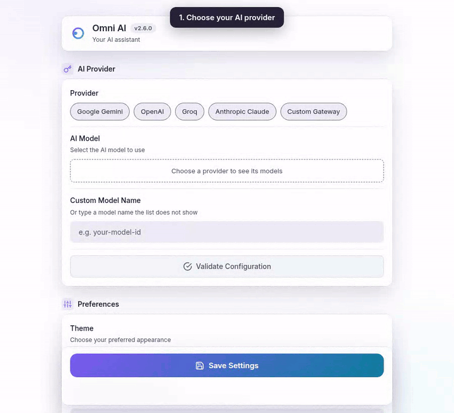

# Omni AI

> 🧠 Your All-in-One AI Browser Companion. Supercharge your Chrome experience with the power of Google Gemini, OpenAI, Groq, Anthropic Claude, and Custom Gateway.

[](https://github.com/ddtcorex/omni-ai)
[](LICENSE)
[](#installation)

Omni AI is a modern, lightweight Chrome extension that integrates advanced AI models directly into your workflow. Whether you're **drafting emails, debugging code, reading foreign articles, or researching complex topics**, Omni AI helps you write better, read faster, and understand everything instantly.

---

## ✨ Features

### 🚀 Smart Selection Actions

Highlight any text on any website to see the **✨ Omni AI Floating Button**. One click gives you access to:

- **Fix Grammar & Spelling**: Professional polish in a click.
- **Rephrase**: Rewrite with different words for better flow.
- **Summarize**: Get the gist of long paragraphs instantly.
- **Change Tone**: Swiftly switch between the Professional, Casual, Friendly, Direct, and Confident presets.
- **Ask AI**: Direct chat contextually based on your selection (the Quick Ask overlay has no default shortcut; bind it at `chrome://extensions/shortcuts` if you want it on the keyboard).
- **Page Tools**: Click the toolbar icon to open a side panel with one-click Summarize / Smart Translate / Explain for the whole page you're on.
- **Sidebar Chat**: A streaming AI chat tab in the side panel: ask about the page you're viewing (auto page context, capped at ~8000 chars), with history and live token-by-token responses streamed over a `chrome.runtime` Port.

### 📋 Writing Enhancements

Dedicated tools for specific needs:

- **Improve Clarity**: Make your thoughts clearer.
- **Make Concise**: Cut the fluff.
- **Expand**: Elaborate with AI-generated depth.
- **Emojify**: Add the perfect emojis for social or chat.

### 📝 Rich Text & Input Support

- **Universal Compatibility**: Works on `input`, `textarea`, and rich text editors like **TinyMCE**.
- **Smart Replacement**: "Replace" button seamlessly updates content in complex editors.

### 🌍 Instant Translation & Explanation

- **Translate**: 43 languages, including Spanish, French, German, Hindi, Arabic, Japanese and both Simplified and Traditional Chinese. `lib/languages.js` holds the full list.
- **Primary Language**: Set your native language (e.g., Vietnamese) for one-click instant translations.
- **Explain**: Simplifies difficult concepts, technical jargon, or complex paragraphs.

### 📊 Dashboard & Usage Statistics

Track your productivity with the new **Usage Dashboard**:

- Monitor **Total Actions** taken.
- See how many **Words Processed** and **Words Generated**.
- Clean, grid-based visualization for your AI activity.

### 🛠️ Premium Settings UI

- **Multiple AI Providers**: **Google Gemini**, **OpenAI**, **Groq**, **Anthropic Claude** and any OpenAI-compatible **Custom Gateway**. Each provider's own model list loads from your key, so a model the vendor ships appears without an update, and a model it retires is flagged.
- **Glassmorphic Design**: A sleek, modern settings page (`settings.html`) with smooth animations and high-resolution visuals.
- **Helper Tooltips**: Interactive instructions and links to help you get your API keys quickly.
- **Context Presets**: Tailor AI responses for Email, Chat, Social Media, Technical, or Academic contexts.

---

## 🚀 Installation

### 1. Clone the repository

```bash
git clone https://github.com/ddtcorex/omni-ai.git
cd omni-ai
```

### 2. Load into Chrome

1. Open Chrome and navigate to `chrome://extensions`.
2. Enable **Developer mode** (top right toggle).
3. Click **Load unpacked**.
4. Select the `omni-ai` directory.

---

## 🔑 Configuration

### 1. AI Provider Configuration (Required)



Open **Settings** (right-click the toolbar icon > **Options**) and work down the **AI Provider** card:

1. **Choose a provider:** Google Gemini, OpenAI, Groq, Anthropic Claude or Custom Gateway.
2. **Paste its API key** and click anywhere outside the field. Omni AI checks the key by loading that provider's model list, so no model call is spent. The line under the key says **Key valid** with the number of models, or shows the provider's own error.
3. **Pick a model** from the buttons. The recommended model comes first, then the newest. A long list shows twelve models and a **Show N more** button, and past thirty models a filter appears.
4. **Validate Configuration** sends one short test request to the chosen model.
5. **Save Settings.**

Where to get a key:

| Provider         | Key page                                                         | Key looks like |
| ---------------- | ---------------------------------------------------------------- | -------------- |
| Google Gemini    | [Google AI Studio](https://aistudio.google.com/app/apikey)       | `AIza...`      |
| OpenAI           | [OpenAI Platform](https://platform.openai.com/api-keys)          | `sk-...`       |
| Groq             | [Groq Console](https://console.groq.com/keys)                    | `gsk_...`      |
| Anthropic Claude | [Anthropic Console](https://console.anthropic.com/settings/keys) | `sk-ant-...`   |

#### Custom Gateway

Connect to any OpenAI-compatible endpoint (OpenRouter, LiteLLM, Together AI, Ollama, your own proxy):

1. Choose **Custom Gateway**.
2. Enter the **Base URL** (e.g. `https://openrouter.ai/api/v1`, `http://localhost:11434/v1`). Its models load once you leave the field.
3. Enter the **API Key** if your gateway needs one; leave it empty for a keyless local gateway.
4. Pick a model, then **Validate Configuration** and **Save Settings**.

The model lists are cached for seven days; the refresh icon on the key line loads a fresh one.

---

### 2. A Model the List Does Not Show

Under the model buttons, **Custom Model Name** takes any model ID your provider accepts, for example a fine-tuned model or a gateway alias.

1. Choose the provider and fill in its key as above.
2. Type the model ID **exactly** as the platform documents it. It is sent verbatim, with no short-name expansion or fuzzy matching. While the field holds a name, no model button is selected; clearing it brings back the model you had picked.
3. **Validate Configuration**, then **Save Settings**.

---

## ⌨️ Keyboard Shortcuts

| Shortcut | Action                                                                         |
| :------- | :----------------------------------------------------------------------------- |
| `Alt+O`  | Show the Quick Actions menu at the current selection                           |
| `Alt+R`  | Rephrase (on selected text)                                                    |
| `Alt+T`  | Smart Translate (auto-detects direction between your two configured languages) |
| `Alt+F`  | Fix Grammar (on selected text)                                                 |

Chrome only auto-binds up to 4 shortcuts per extension, so these are the 4 with a default binding. Opening the side panel, Quick Ask, Summarize, and Explain are also available as commands but need to be bound manually, like all shortcuts here, at `chrome://extensions/shortcuts`.

---

## 🌍 Multilingual Support

Omni AI has two independent language settings: the languages you can **translate into**, and the language the **interface** is displayed in. They are not the same list, and you can mix them freely, for example running a Vietnamese interface while translating into Japanese.

### Translation languages (43)

`lib/languages.js` (`LANGUAGES`) is the single source of truth for this list. The Settings pickers render it as a plain `<select>` grouped into Common and All, and the AI prompts read the language names from the same file.

Amharic, Arabic, Bengali, Chinese (Simplified), Chinese (Traditional), Czech, Danish, Dutch, English, Filipino, Finnish, French, German, Greek, Gujarati, Hausa, Hebrew, Hindi, Hungarian, Indonesian, Italian, Japanese, Javanese, Korean, Malay, Marathi, Norwegian, Persian, Polish, Portuguese, Punjabi, Romanian, Russian, Spanish, Swahili, Swedish, Tamil, Telugu, Thai, Turkish, Ukrainian, Urdu, Vietnamese.

The source language is never configured: the model infers it. Pin a **Primary Language** in Settings for one-click translations, and Smart Translate picks the direction for you (text in your primary language goes to your default language, anything else goes to your primary language).

### Interface languages (52)

The whole extension UI is localized, and Chrome selects the locale that matches your browser language automatically. The exact list is `UI_LOCALE_CODES` in `lib/languages.js`, and a test asserts it matches the `_locales/` directories on disk. Language **names** inside the pickers are the one deliberate exception: they come from the registry as reference data (each with an English and a native name) rather than being duplicated into every catalogue.

---

## 📁 Project Structure

```text
omni-ai/
├── manifest.json           # Extension Manifest V3
├── background/             # Background service worker
│   └── service-worker.js   # Message router, context menus, commands, side panel
├── content/                # Injected scripts & UI
│   ├── content.js          # Selection tracking, floating button, result cards
│   ├── editor-adapters.js  # input / textarea / contenteditable adapters
│   ├── positioning.js      # Viewport clamping helpers
│   └── overlay.css         # Styles injected into the Shadow DOM root
├── sidepanel/              # Side panel: Page Tools + streaming Chat tab
│   ├── sidepanel.html
│   ├── sidepanel.js
│   └── sidepanel.css
├── lib/                    # Shared logic & AI Providers
│   ├── ai-service.js       # AI Dispatcher and prompt builders
│   ├── ai-providers.js     # Provider & model registry
│   ├── languages.js        # Translation language registry (43 codes)
│   ├── i18n.js             # Shared i18n wrapper
│   ├── storage.js          # Typed owner of the Storage Map keys
│   ├── history.js          # Statistics & History management
│   ├── theme-manager.js    # Theme apply/broadcast
│   ├── sidebar-chat.js     # Chat prompt builder (page context + history)
│   ├── omni-chat-port.js   # Streaming chat Port handler ("omni-chat")
│   ├── design-tokens.css   # Canonical --omni-* custom properties
│   ├── design-system.css   # Shared .ds-* component classes
│   └── providers/          # AI Model Implementations
│       ├── gemini.js
│       ├── groq.js
│       ├── openai.js
│       ├── anthropic.js
│       └── custom-gateway.js
├── _locales/               # chrome.i18n catalogues (52 locales)
├── assets/                 # Branding & high-res icons
├── settings.html           # Main configuration page
├── settings.js
├── settings.css
├── tests/                  # Jest 30 + jsdom + shared chrome mock
├── e2e/                    # Playwright specs
└── scripts/                # Build & utility scripts
    └── publish.sh          # Strips the dev key and zips dist/
```

---

## 🛠️ Tech Stack

- **Manifest V3**: Using the latest Chrome extension standards.
- **Vanilla JavaScript**: Lightweight, no heavy frameworks, maximum performance.
- **Modern CSS**: Variables, Flex/Grid, Glassmorphism, and smooth animations.
- **Provider Architecture**: Easily extendable to add new AI providers. See `lib/providers/` and the `AI_PROVIDERS` registry.

---

## 🤝 Contributing & CI Gate

`master` is **branch-protected**: you cannot push to it directly, and a PR can
only merge when **both** GitHub checks are green (`verify` and `e2e (playwright)`)
and the branch is up to date with `master`. Contributors (human or AI agent)
must therefore run the local equivalent of the pipeline **before** pushing:

```bash
npm run verify          # typecheck + ESLint + Prettier --check + Jest coverage
npx playwright test     # E2E: extension loads in MV3, side panel, smoke
```

- Never push a known-red state and rely on CI to catch it. Fix locally and
  re-run until both commands are green.
- Keep your feature branch rebased/up to date with `master` so the
  "up-to-date before merge" check passes.
- Exact CI invocations live in `.github/workflows/ci.yml`. Treat that file as
  the source of truth for what the gate runs.

See `AGENTS.md` ("Pre-Push Gate") for the full agent checklist that mirrors this
pipeline.

---

## 📦 Publishing to the Chrome Web Store

Follow this guide to publish **Omni AI** to the official Chrome Web Store.

### 1. Prepare the Distribution Zip

First, you need to create a clean `.zip` file containing only the necessary files for the extension to run.

#### Automated Build Script (Recommended)

We provide a script that automatically handles versioning and removes the development `key` field (used locally to keep a stable extension ID, but forbidden on the Web Store).

```bash
# Make the script executable (first time only)
chmod +x scripts/publish.sh

# Run the build script
./scripts/publish.sh
```

This will create `omni-ai-vX.X.X.zip` in the root directory, ready for upload.

### 2. Create a Developer Account

To publish on the Chrome Web Store, you need a Google Developer account.

1. Go to the [Chrome Web Store Developer Console](https://chrome.google.com/webstore/devconsole).
2. Sign in with your Google Account.
3. Pay the one-time **$5 USD** developer registration fee.
4. Complete your developer profile.

### 3. Upload and Configure

1. **Upload**: Click **+ New Item** and upload your `.zip`.
2. **Store Listing**: paste the text from `docs/CHROME_WEBSTORE_LISTING.txt`, which
   holds the description field as well as the remaining dashboard fields
   (product name, summary, category, languages, single purpose, screenshots).
   - **Icons**: Use `assets/icons/` (ensure 128x128 PNG is available or convert SVG).
   - **Screenshots**: the dashboard has two fields, "Localized screenshots" and
     "Screenshots shown in all languages" (up to five each, 1280x800 or 640x400,
     PNG 24-bit without alpha or JPEG). Both take the same five scenes; see
     `docs/CHROME_WEBSTORE_LISTING.txt` for the list and the order.
   - **Category**: Productivity or Search Tools.
3. **Privacy & Permissions**: paste the permission justifications and the data
   collection answers from `docs/PERMISSION_JUSTIFICATIONS.txt`, and link the
   published copy of `docs/PRIVACY_POLICY.md`.

### Pro Tips for Approval

- **Screenshot Quality**: Use high-quality screenshots. Show the ✨ floating button and the action menu on a highlighted paragraph, a result with Replace, the side panel, the settings page and Quick Ask.
- **Clear Description**: Clearly explain that users need an API key (Gemini, OpenAI, Groq, Anthropic Claude) or Custom Gateway to use the extension.
- **Permission Scope**: Chrome reviewers prefer the narrowest permissions possible.

---

## 🤝 Contributing

Contributions are welcome! Whether it's fixing a bug, adding a new feature, or improving documentation:

1. **Fork** the repository.
2. **Create a feature branch**: `git checkout -b feature/amazing-feature`.
3. **Commit your changes**: `git commit -m 'feat: add amazing feature'`.
4. **Push to the branch**: `git push origin feature/amazing-feature`.
5. **Open a Pull Request**.

### Coding Guidelines

- Use **Vanilla JavaScript** (ES6+). Avoid adding external frameworks or heavy libraries.
- Maintain the **CSS Variable** system for styling.
- Ensure any new AI providers follow the existing pattern in `lib/providers/`.

---

## 📄 License

This project is licensed under the GPL-3.0 License. See the [LICENSE](LICENSE) file for details.

---

Made with ❤️ by [ddtcorex](https://github.com/ddtcorex)
